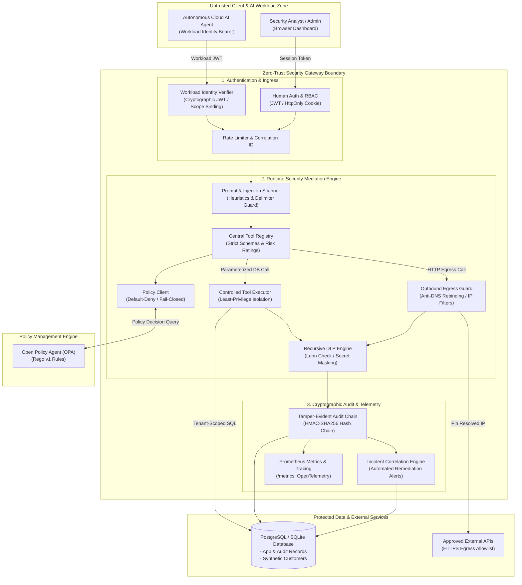

# Zero-Trust Runtime Security Gateway - Architecture & Threat Model

## 1. System Architecture Overview

The Zero-Trust Runtime Security Gateway is designed on the foundational premise: **"Never trust an AI agent's decision; authenticate the workload, authorize every protected action, validate its arguments, execute only approved operations, inspect resulting data, and record an immutable security event."**

Prompt-injection defense is treated as a defense-in-depth layer rather than the sole perimeter boundary.

---

## 2. Trust Boundaries and Threat Model

### Trust Boundaries (TB)
1. **TB-1: Agent Workload Boundary**: The AI model / agent code is completely untrusted. Even if compromised by prompt injection, it has no direct network access or database credentials.
2. **TB-2: Gateway Ingress Boundary**: All requests must present a signed, non-expired workload identity token. Workload identity is bound to a specific `tenant_id` and permitted tool scopes.
3. **TB-3: Policy Enforcement Point (PEP)**: The gateway queries OPA before dispatching any tool. Production mode fails closed.
4. **TB-4: Execution & Data Boundary**: Operations on data use predefined parameterized queries. Model-generated arbitrary SQL is never executed.
5. **TB-5: Egress Network Boundary**: Outbound HTTP requests must be pre-resolved, checked against forbidden private/loopback/cloud-metadata networks, and bound to approved hostnames.
6. **TB-6: Egress DLP Boundary**: Data returned by tools is recursively inspected and redacted for PII and secrets prior to reaching the agent or operator.
7. **TB-7: Audit Storage Boundary**: Audit events are persisted in a tamper-evident SHA-256 HMAC hash chain, preventing undetected tampering or retroactive deletion.

### STRIDE Threat Analysis

| Threat Category | Potential Attack Vector | Gateway Mitigation Control |
| :--- | :--- | :--- |
| **Spoofing** | Attacker calls gateway claiming another `agent_id` in request body. | Gateway rejects request body `agent_id` and binds execution exclusively to cryptographically verified JWT subject (`workload.agent_id`). |
| **Tampering** | Rogue actor modifies audit logs to conceal unauthorized access. | Cryptographic HMAC-SHA256 hash chaining. `verify_audit_log_integrity` pinpoints any record modification or gap. |
| **Repudiation** | Operator denies reviewing or altering security incidents. | Role-Based Access Control (RBAC) logs user identities on notes and status changes. |
| **Information Disclosure** | AI agent attempts to exfiltrate credit cards, SSNs, or AWS keys. | Recursive DLP engine inspects strings, arrays, and objects, applying Luhn validation and regex masking before return. |
| **Denial of Service** | Model sends 10MB payload or requests 10,000 database rows. | Strict row limits (max 20 rows), input length caps (4000 chars), and HTTP response size bounding (512KB). |
| **Elevation of Privilege** | Prompt injection commands agent to execute `DROP TABLE customers`. | Tool registry enforces `allowed_operations=["SELECT"]`. Parameterized query templates never execute DDL/DML. |
| **SSRF** | Agent tricked into hitting `http://169.254.169.254/latest/meta-data`. | Controlled HTTP client resolves DNS, rejects link-local / RFC 1918 / loopback IPs, and verifies domain allowlist. |
